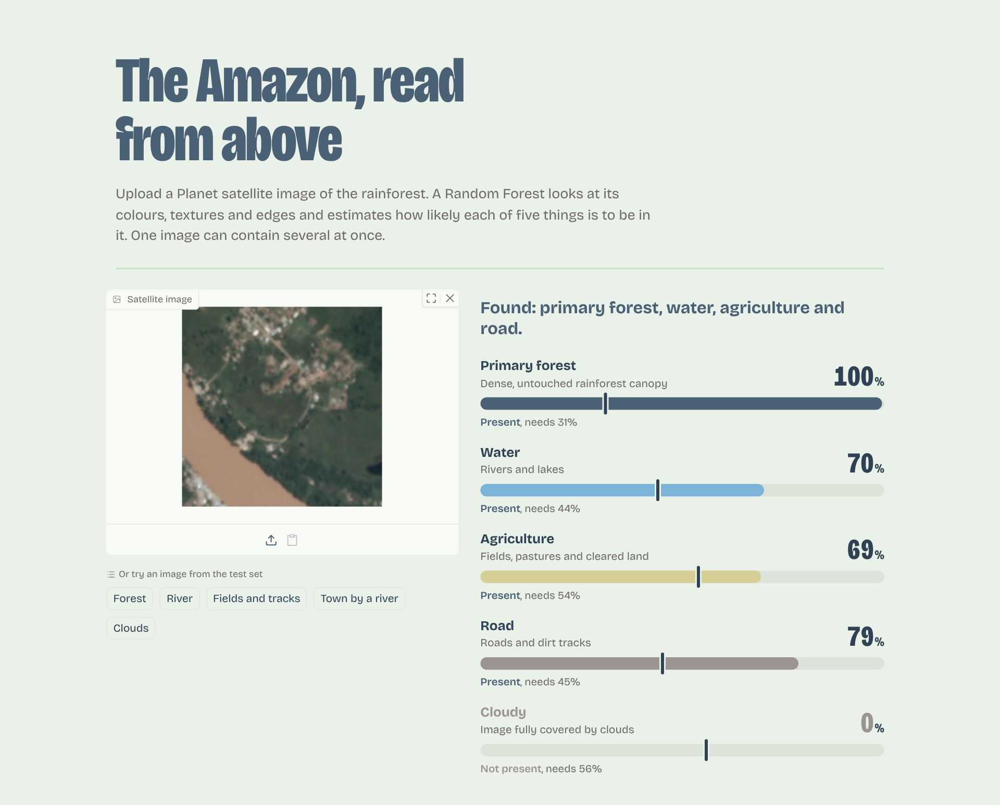
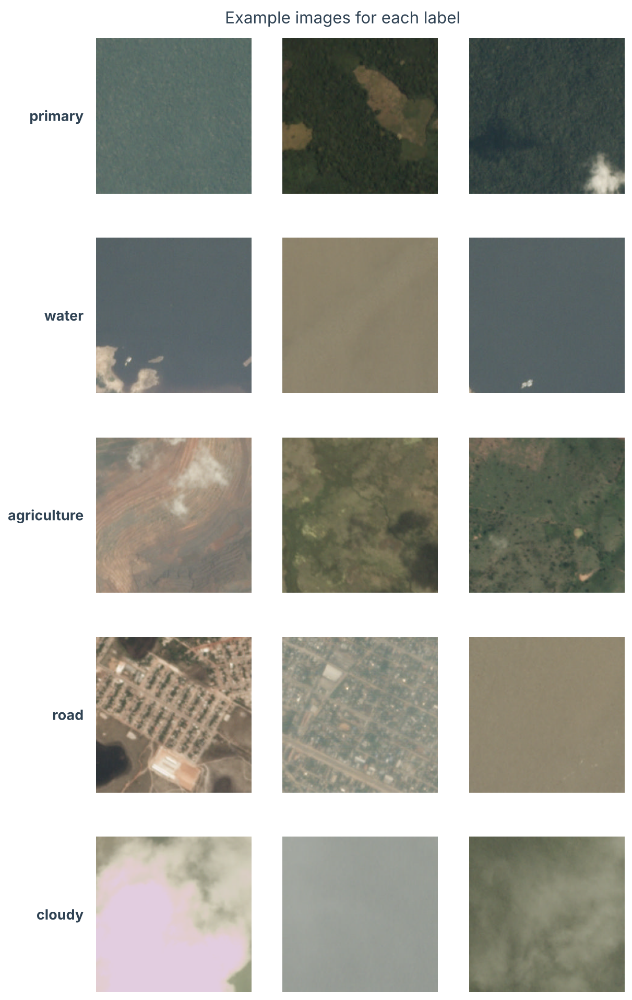
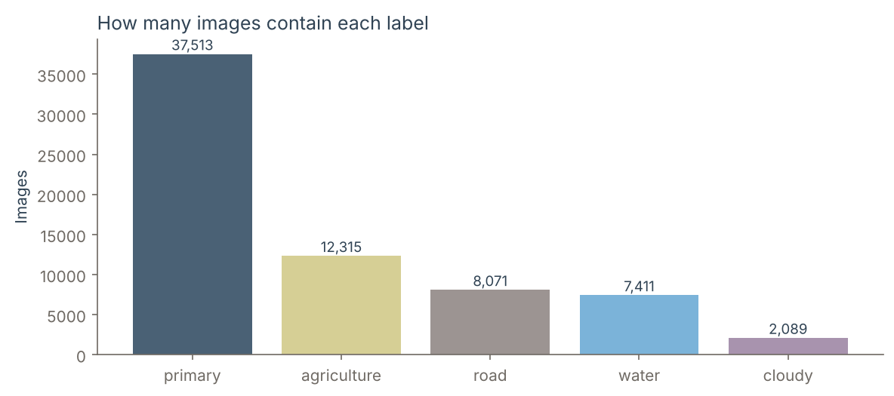
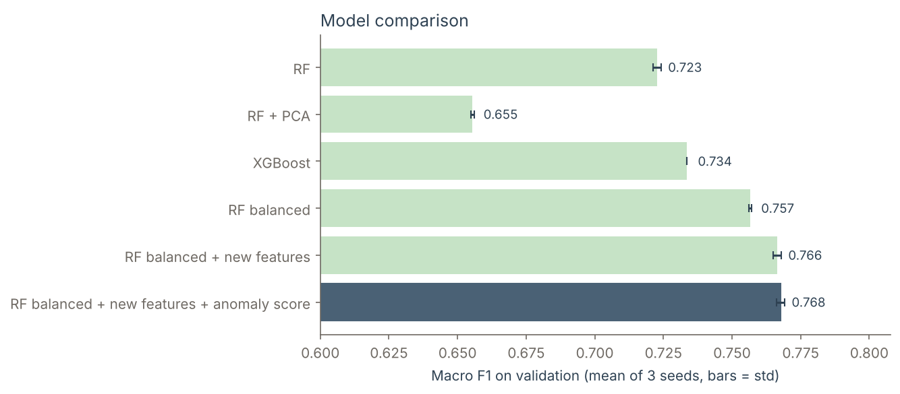
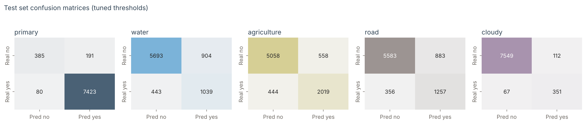
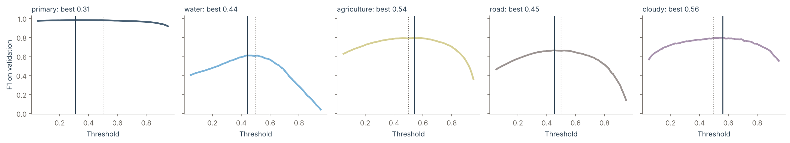
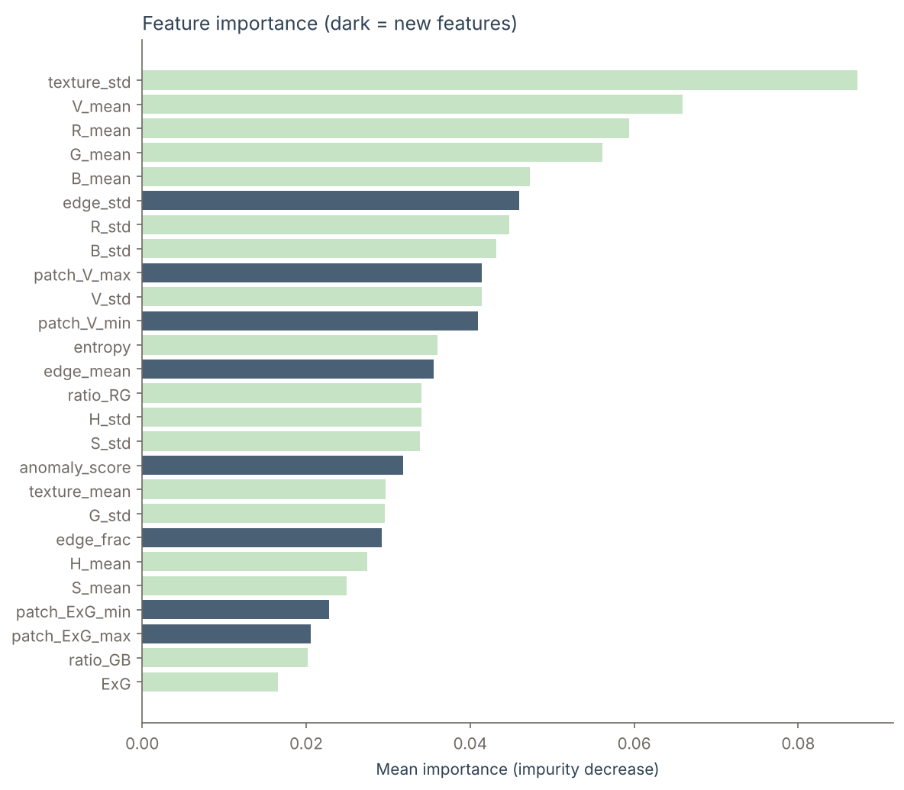

# Amazon Satellite Image Classifier

Recognises what is visible in a satellite image of the Amazon rainforest: **primary forest, water, agriculture, roads and clouds**.
Upload an image and the model returns the probability of each label.

<p align="center">
  
</p>

*A test image the model never saw during training. It finds forest, water, agriculture and a road, which are exactly its real labels. The dark tick on each bar is that label's decision threshold.*

---

## The problem

Deforestation in the Amazon is monitored from space. Thousands of images arrive every day and nobody can look at them one by one.
This project teaches a model to read each image and say what is in it.

An image can contain **several things at once** (forest *and* a road *and* fields). That is why this is a **multi-label** problem: for each label the model answers yes or no independently, instead of picking only one class.

## The 5 labels

<p align="center">
  
</p>

<p align="center">
  
</p>

The labels are very unbalanced: 93% of the images contain primary forest, only 5% are cloudy.

## How it works

Instead of a neural network, the model works with **25 numbers that describe each image**, so every decision can be explained.

```
Satellite image (256x256)
        │
        ▼
25 features ──► colour: mean and spread of R, G, B and H, S, V
        │       vegetation index ExG = 2G − R − B
        │       texture: how much brightness varies inside small patches
        │       colour ratios R/G, G/B and brightness entropy
        │       edges (Sobel): roads and river banks are sharp lines
        │       extreme patches: the darkest, brightest, least and most green 8x8 patch
        ▼
Standardisation + Isolation Forest anomaly score
        │
        ▼
Random Forest with balanced class weights (one forest per label)
        │
        ▼
Probability of each label ──► present if above that label's threshold
```

The same `src/features.py` is used for training and in the demo, so the two can never drift apart.

## How the evaluation is kept honest

| Split | Images | Used for |
|---|---|---|
| Train | 24,235 (60%) | fitting the models |
| Validation | 8,079 (20%) | choosing the model, hyperparameters and thresholds |
| Test | 8,079 (20%) | measured **once**, at the end |

- **Macro F1** is the main metric: the average F1 over the 5 labels, so `water` counts as much as `primary`.
- A **lazy baseline** that always answers "primary" sets the floor: macro F1 0.19 (but 0.96 on `primary` alone, so a high score on that label means little).
- Every model is trained with **3 random seeds**. A difference smaller than the spread between seeds is treated as noise.

## Results

### Choosing the model (validation)

<p align="center">
  
</p>

| Model | water | road | Macro F1 |
|---|---|---|---|
| Random Forest | 0.50 | 0.60 | 0.723 ± 0.002 |
| Random Forest on 5 PCA components | 0.34 | 0.53 | 0.655 ± 0.001 |
| XGBoost | 0.52 | 0.62 | 0.734 ± 0.000 |
| Random Forest, balanced class weights | 0.59 | 0.65 | 0.757 ± 0.000 |
| + edge and patch features | 0.60 | 0.66 | 0.767 ± 0.001 |
| **+ anomaly score (final model)** | **0.60** | **0.66** | **0.768 ± 0.002** |

What this shows:
- **Balanced class weights helped the most**: water went from 0.50 to 0.59. Without them, the model learns that "no water" is almost always right.
- **PCA hurt**: 5 components keep 90% of the variance, but the 10% that is lost contains the signal for water and roads.
- **The new edge and patch features helped** (+0.010, well above the noise between seeds).
- **The anomaly score barely helped** (+0.001, the same size as the noise). It stays because it was the best on validation and the demo needs it anyway.

### Final result (test set)

| | primary | water | agriculture | road | cloudy | **Macro F1** |
|---|---|---|---|---|---|---|
| Lazy baseline | 0.963 | 0 | 0 | 0 | 0 | 0.193 |
| **Final model** | 0.982 | 0.607 | 0.801 | 0.670 | 0.797 | **0.771** |

<p align="center">
  
</p>

`water` and `road` are still the hard labels: thin rivers and dirt tracks cover few pixels and look like bare soil.

### An experiment that did not work: one threshold per label

Instead of using 0.5 for every label, I tuned a threshold per label on validation. It gained only +0.004 on validation and **nothing on test** (0.7713 vs 0.7717 with 0.5). The F1 curves are almost flat around 0.5, because the balanced class weights had already moved the probabilities to a good place.

<p align="center">
  
</p>

The tuned thresholds are kept anyway: they were chosen before looking at the test set, and switching back to 0.5 because of the test score would mean using the test set to make a decision.

### Which features matter

<p align="center">
  
</p>

**Texture variation** is the most important feature: forest, fields and roads differ more in how rough they look than in their colour. Several of the new features (dark), such as edge variation and the brightest and darkest patch, are among the top 12.

## Try the demo

```bash
git clone https://github.com/<your-username>/amazon-satellite-image-classifier.git
cd amazon-satellite-image-classifier
pip install -r requirements.txt
python demo/app.py
```

Open http://localhost:7860, upload an image or click one of the examples. The trained model is already in `models/`, so the demo works without downloading the dataset.

The 5 examples are test-set images from the Kaggle dataset:

| Example | Real labels |
|---|---|
| Forest (`train_23477.jpg`) | primary |
| River (`train_11173.jpg`) | primary, water |
| Fields and tracks (`train_28412.jpg`) | primary, agriculture, road |
| Town by a river (`train_6545.jpg`) | primary, water, agriculture, road |
| Clouds (`train_23634.jpg`) | cloudy |

If an uploaded image is more unusual than 99% of the training images (Isolation Forest anomaly score), the demo warns that its numbers are unreliable. This happens with normal photos, charts or images from other satellites.

## Retrain from scratch

1. Download **Planet: Understanding the Amazon from Space** from [Kaggle](https://www.kaggle.com/c/planet-understanding-the-amazon-from-space).
2. Place it like this:
   ```
   data/raw/planet/train_classes.csv
   data/raw/planet/train-jpg/*.jpg
   ```
3. Run `notebooks/amazon_planet.ipynb` from top to bottom (about 25 minutes on a 2-core machine). It extracts the features, compares the models, saves the figures in `figures/` and the final model in `models/`.

## Project structure

```
├── demo/
│   ├── app.py              # web demo (Gradio)
│   └── examples/           # 5 test images from the Kaggle dataset
├── figures/                # charts generated by the notebook + demo screenshot
├── models/                 # trained model, scaler, Isolation Forest, thresholds
├── notebooks/
│   └── amazon_planet.ipynb # full analysis: EDA, features, models, evaluation
├── src/
│   └── features.py         # extraction of the 25 features
└── requirements.txt
```

## Tech stack

Python · scikit-learn (Random Forest, Isolation Forest, PCA, Grid Search) · XGBoost · NumPy · pandas · Pillow · Matplotlib · seaborn · Gradio

## Data

Images and labels: [Planet: Understanding the Amazon from Space](https://www.kaggle.com/c/planet-understanding-the-amazon-from-space) (Planet Labs, Kaggle competition).

## Author

**Angel Bohorquez**, AI & Machine Learning program, ITS Angelo Rizzoli (Milan)
